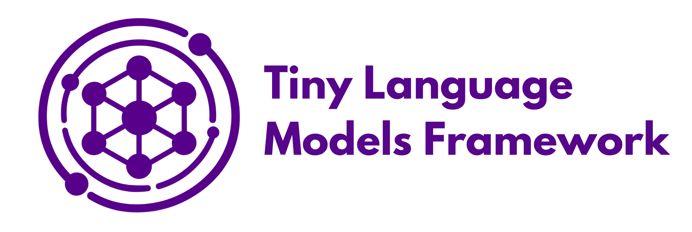
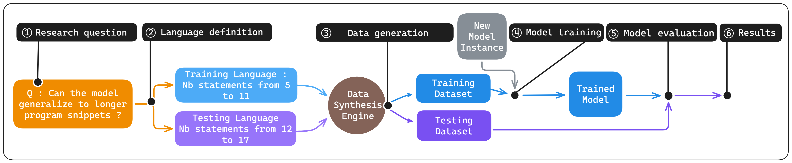

# Tiny Language Models Framework

A research framework designed as a free and accessible playground for formulating and testing hypotheses about transformer-based language models. The framework facilitates detailed experimentation with small-scale language models, beginning with controlled synthetic datasets before validating findings across different models and real-world data. Its ultimate goal is to uncover fundamental properties and emergent behaviors that may also arise in larger language models.

The [2026 release](release_2026/README.md) brings together two parts of this workflow: **TinyTracer**, for experiments on controlled synthetic programs, and **Other Models**, for testing hypotheses on code corpora and established benchmarks.

## TinyTracer

TinyTracer is a controlled testbed for studying how small decoder-only transformers learn program behavior. It pairs synthetic Python programs with execution traces produced by the Python interpreter, so experiments can control the training distribution and test what happens when one property changes. The restricted language keeps training practical, while the stepwise trace makes it possible to locate a failure at a particular instruction, variable, or generated token.

### Research pipeline

  

1. **Define a research question.** For example, can a model trace programs longer than those seen during training?
2. **Define the language and distributions.** Choose the allowed statements and generation rules, then specify the difference between training and testing. A length experiment might train on 5–11 statements and test on 12–17.
3. **Generate the data.** Synthesize programs, execute them to obtain reference traces, filter examples, and prepare training, validation, and test sets.
4. **Train a model.** Start a new model instance on the generated training set and save checkpoints throughout training.
5. **Evaluate the checkpoints.** Compare predicted traces with reference traces on both in-distribution and out-of-distribution test sets.
6. **Analyze the results.** Compare performance across checkpoints, model configurations, and controlled changes to the data.

The usable baseline is in [`release_2026/dry_framework/`](release_2026/dry_framework/README.md). Its data generation, training, and evaluation scripts form the starting point for new experiments.

### Data generation: Tiny-alpha and Tiny-beta

These are proper subsets of Python: they use Python syntax and execution semantics, with a restricted set of constructs that can be generated under precise rules.

| Language | Program constructs | What it lets us study |
| --- | --- | --- |
| **Tiny-alpha** | Integer assignments, arithmetic expressions, and nested `if` statements | Arithmetic, branching, nesting, program length, and variable naming |
| **Tiny-beta** | Tiny-alpha constructs plus bounded `for` loops | Repeated execution, loop variables, and interactions between loops and branches |

Both languages use integer values, simple assignments, addition or subtraction, and `<` / `>` comparisons. Expressions contain at most one arithmetic operation; floating-point values, multiplication, division, and remainder are excluded. Tiny-beta adds bounded loops whose index variables are kept separate from other assignments.

Generation rules control statement counts, nesting depth, integer ranges, arithmetic operators, and variable name length and diversity. Test sets can follow the training rules or deliberately change them to measure generalization. These settings belong to each experiment rather than defining one fixed dataset.

The generator first builds a statement skeleton, then instantiates it with concrete variables, values, and operators. Python tracing hooks collect instruction positions and variable states during execution; runtime filters reject exceptions or values outside the configured range. Hash-based deduplication removes repeated examples before the generated corpus is split into training, validation, and test sets.

The baseline data preparation runs in this order:

1. [`tinypy_code_tracing_generator.py`](release_2026/dry_framework/data_generation/tinypy_code_tracing_generator.py) generates programs and traces, together with generation statistics.
2. [`determinism_filtering.py`](release_2026/dry_framework/data_generation/determinism_filtering.py) filters examples whose trace-step context exceeds the configured token window.
3. [`data_preparation.py`](release_2026/dry_framework/data_generation/data_preparation.py) splits and tokenizes the retained examples into training, validation, and test files.

Tiny-alpha is the baseline generator. Tiny-beta has a [replacement generator and tokenizer](release_2026/dry_framework/data_generation/beta_replacement_scripts/) and a [matching evaluation tokenizer](release_2026/dry_framework/evaluation/beta_replacement_scripts/). Use the matching tokenizer throughout preparation, training, and evaluation. Dataset sizes, paths, and generation settings are configured in the scripts; see the [baseline instructions](release_2026/dry_framework/README.md#21-data_generation).

The custom tokenizer encodes identifier letters and number digits individually, while keeping keywords, operators, indentation, and trace markers as fixed tokens. Tiny-beta extends this vocabulary with loop keywords and parentheses. Prepared token IDs are stored in binary files for training.

### Code tracing task

The task is **TinyTracing**: given a program and its current execution state, predict the next annotated state. Each step repeats the full program, marks the instruction position with `@`, and records variable values after `$`; `#STEP` separates successive states. The model generates the next step token by token, feeding its predictions back into the context. Starting from the program prompt, this produces the complete execution trace.

Branches determine which lines are reached, and loops revisit earlier lines. Explicit instruction and variable annotations let us check the predicted state transitions and identify the first point where a trace diverges.

  

In this example, `r` becomes `57`, the condition is true, and the loop runs twice. The trace follows the assignments to `q` and `l` on each iteration and ends with the final variable state. Predicting the full trace requires the model to reproduce the intermediate execution steps as well as the final values.

The main evaluation measure is **exact-match accuracy over the full trace**: every step, variable value, instruction marker, and structural delimiter must match the reference. A correct final state alone does not count as a correct trace. The baseline evaluator records full-trace matches as `hard-accuracy` and separately records final-line matches among the remaining predictions as `soft-accuracy`.

### Training, evaluation, and research experiments

[`optimus_train.py`](release_2026/dry_framework/training/optimus_train.py) trains a compact GPT2-style decoder-only transformer from scratch on the prepared data and saves checkpoints and `best-model.pth`. [`eval.py`](release_2026/dry_framework/evaluation/eval.py) evaluates one checkpoint on one test set, recording trace matches and saving successful and failed predictions. [`scheduler.py`](release_2026/dry_framework/evaluation/scheduler.py) schedules evaluations across checkpoints and test sets.

For setup and execution order, follow the [TinyTracer baseline guide](release_2026/dry_framework/README.md). The scheduler uses Linux `screen` sessions; its environment and scheduling settings are described there.

The 2026 research folders contain configurations for two questions:

- [Research question 1](release_2026/research_question_1/README.md): robustness to distribution shifts, including changes in program structure and variable names, with model and tokenization comparisons.
- [Research question 2](release_2026/research_question_2/README.md): robustness to variable renaming, comparing training sets with different variable diversity and testing semantics-preserving renamings.

Use the baseline to learn the workflow, then use these folders to reproduce or adapt the research configurations.

## Other Models

[`release_2026/other_models/`](release_2026/other_models/) extends the experiments to small causal language models trained on real Python code. It includes dataset download and preparation, model training and loading, standard benchmark evaluation, and controlled variable-renaming experiments.

Start with the [documentation index](release_2026/other_models/docs/README.md), [environment setup](release_2026/other_models/docs/environment.md), and [quick start](release_2026/other_models/docs/quickstart.md). The quick start trains a small Llama checkpoint and evaluates a small PY150 sample.

### Models

| Model | Architecture option | Parameters | Default training dataset |
| --- | --- | ---: | --- |
| Small StarCoder | `starcoder` / `gpt_bigcode` | 18.9M | CodeSearchNet |
| Small Llama | `llama` | 18.3M | CodeSearchNet |
| Small GPT-NeoX | `gpt_neox` | 18.3M | The Vault |

These presets initialize new models with random weights. Training saves the model and tokenizer together; saved checkpoints can then be loaded for generation, continued training, or evaluation. Any model can use another supported training corpus through `--dataset`.

See [models and training](release_2026/other_models/docs/models-training.md) for architecture details, configuration recipes, tokenizer selection, and checkpoint loading.

### Training datasets

| Dataset | CLI key | Prepared data |
| --- | --- | --- |
| CodeSearchNet | `codesearchnet` | Python function training records |
| The Vault | `thevault` | Python function records from all available training partitions |
| CodeParrot | `codeparrot` | Python code from the clean corpus |

Downloads include the complete source repository by default. Preparation selects eligible Python training records, removes duplicates, and excludes repositories and functions found in the CodeSearchNet heldout reference split.

Smaller runs are explicit: `--n-docs` limits prepared documents, while `--max-files` or download file patterns limit the source transfer. A document limit alone does not reduce the raw download. Local source caches can be reused. See [training datasets](release_2026/other_models/docs/datasets.md) for download scopes, filters, and subset options.

### Benchmarks and evaluation

Seven standard benchmark routes evaluate different aspects of code modeling:

| Benchmark | Task | Main metrics | Optional fine-tuning |
| --- | --- | --- | --- |
| CodeXGLUE PY150 | Python lexical token completion | Token accuracy | Yes |
| CodeXGLUE Cloze-all | Rank masked identifier candidates | Accuracy | No |
| CodeXGLUE Cloze-max/min | Choose a masked `max` or `min` | Accuracy | No |
| BIFI | Repair syntax errors | Repair accuracy, error groups | Yes |
| ManyTypes4Py | Rank type annotations | Exact match at 1/5/10, MRR at 10, parametric match | Yes |
| CRUXEval-I | Find inputs producing a given output | pass@1, pass@5 | No |
| CRUXEval-O | Predict a function call's output | pass@1, pass@5 | No |

Benchmark preparation downloads full releases and retains all available splits by default. Evaluation scores every prepared test example unless a positive `--limit` is supplied. Standard evaluation defaults to `--device auto`, choosing CUDA when available and CPU otherwise.

A saved checkpoint can be evaluated directly without benchmark training. PY150, BIFI, and ManyTypes4Py also support optional fine-tuning on their training splits. Fine-tuning creates a **new checkpoint** in the run directory. Cloze and CRUXEval provide evaluation data only.

Runs retain predictions, metrics, example counts, source manifests, and checkpoint/data hashes. Follow the [benchmark guide](release_2026/other_models/docs/benchmarks.md) for preparation and evaluation commands, the [metrics guide](release_2026/other_models/docs/metrics.md) for score definitions, and [runs and reproducibility](release_2026/other_models/docs/reproducibility.md) for output files and provenance.

### Variable-renaming experiments

The [variable-renaming experiment](release_2026/other_models/docs/variable-renaming.md) compares three training conditions on the same documents: original code (`plain`), partial local-variable renaming (`halfvar`), and renaming with fresh names across the corpus (`highdiv`). Paired evaluation views use rename caps of 0, 1, 2, 4, and 8 to measure accuracy and retention of previously correct predictions.

Its ten tasks cover identifier reproduction, variable misuse, token completion, cloze prediction, and CuBERT code-error detection. The experiment reuses the shared model, dataset, and benchmark services, including existing CodeXGLUE downloads and prepared data. Existing checkpoints can be evaluated directly, or each controlled training condition can produce a separate checkpoint.

See the [experiment guide](release_2026/other_models/docs/variable-renaming.md) for training campaigns, paired evaluation, scoring, and reports, and the [command reference](release_2026/other_models/docs/commands.md) for CLI options.

## Repository layout

| Location | Contents |
| --- | --- |
| [`release_2026/`](release_2026/README.md) | Current release and research configuration overview |
| [`release_2026/dry_framework/`](release_2026/dry_framework/README.md) | TinyTracer baseline: generation, training, and evaluation |
| [`release_2026/other_models/`](release_2026/other_models/docs/README.md) | Small code models, corpora, benchmarks, and experiments |
| [`release_2025/`](release_2025/) | Earlier research projects and their shared datasets |
| [`code_tracing_demo/`](code_tracing_demo/) | Earlier code tracing demonstration pipeline |

Generated datasets, checkpoints, and evaluation outputs are created by the workflows and are not included in the repository.

## Contact

For any questions, please refer to the documentation or contact one of the maintainers:

- Zakaria Soualah Mohammed: [zs3741@nyu.edu](mailto:zs3741@nyu.edu)
- Ibrahim Aboud: [ia2921@nyu.edu](mailto:ia2921@nyu.edu)
- Younes Boukacem: [yb2618@nyu.edu](mailto:yb2618@nyu.edu)
- Hodhaifa Benouaklil: [hb3020@nyu.edu](mailto:hb3020@nyu.edu)

## License

This project is licensed under the MIT License. See the [LICENSE](https://opensource.org/license/mit) website for details.

# Acknowledgements

This work was supported in part through the NYU IT High Performance Computing resources, services, and staff expertise.